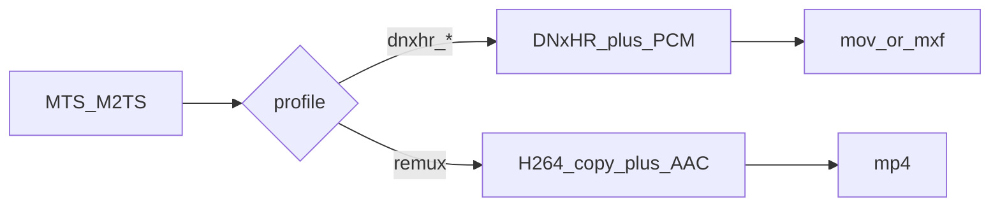

# Add MTS Remux Mode

## Goal

Let users remux `.MTS` / `.M2TS` to `.mp4` with **video stream copy** and **AAC audio**, via CLI and GUI, while keeping DNxHR HQX as the default Resolve path. **No rename** of the repo, `mts_to_dnxhr.py`, GUI module, or `MTS-to-DNxHR.exe`.

## Locked decisions

- Remux encode: `-c:v copy`, audio `aac` (not AC-3 copy), container always `.mp4`
- CLI: `--profile remux`
- GUI: mode control (DNxHR vs Remux)
- Default output folders: `remux/` / `*_remux` when remuxing; keep `dnxhr/` / `*_dnxhr` for DNxHR
- Names stay `mts-to-dnxhr` / MTS-to-DNxHR

## Constraints

- Encode path stays in [`mts_to_dnxhr.py`](../../mts_to_dnxhr.py); GUI only collects options and calls `core.convert_one` / `run_batch`
- Remux must not change default DNxHR HQX / `.mov` behavior
- Deinterlace and PCM bit-depth do not apply to remux (`-c:v copy`)
- No repo/app/exe rename in this work

## Approach

Extend [`mts_to_dnxhr.py`](../../mts_to_dnxhr.py) so `build_command` branches on profile. Remux is a profile choice, not a separate tool.

**CLI validation when `profile == remux`:**
- Force container `mp4` (add `mp4` to `CONTAINERS`)
- Reject or error if `--container` is not `mp4` (default remux container to `mp4` when profile is remux)
- Reject `--audio-bit-depth` and `--deinterlace` as errors (deinterlace cannot apply with `-c:v copy`)
- Keep `--hwaccel` optional; remux still decodes audio for AAC. Default can stay `cuda`; document that video is not re-encoded

**FFmpeg remux shape** (in `build_command`):
- `-fflags +genpts` (MPEG-TS → MP4 timing)
- `-c:v copy`
- `-c:a aac -b:a 192k -ar 48000` (channel count from source via map)
- `-movflags +faststart`
- `-f mp4`
- No `-vf`, no DNxHR/`pix_fmt`, no PCM

**Defaults:**
- `default_output_dir` takes profile (or a small helper): remux → `remux` / `{name}_remux`; DNxHR unchanged
- Parser: `--profile` choices = DNxHR keys + `remux`; when remux, default container becomes `mp4` (argparse post-parse in `main` is fine)

**GUI** ([`mts_to_dnxhr_gui.py`](../../mts_to_dnxhr_gui.py)):
- Add a simple mode control in Export settings (dropdown or radios): **DNxHR HQX** (default) vs **Remux MP4**
- Remux selected → `Options(profile="remux", container="mp4", …)`; disable deinterlace checkbox; update summary text; disk estimate ~**1×** source size (not `SIZE_RATIO = 14`); refresh default export folder name when mode changes and the path still looks like the previous auto default
- GPU decode / jobs still apply

Rejected alternatives: ProRes; pure AC-3 copy remux; H.264 re-encode delivery; renaming the product.

## Steps

1. Core: remux profile + `mp4` container + `build_command` branch + `default_output_dir` + CLI validation/defaults
2. GUI: mode control, options wiring, estimate/summary/export-folder behavior
3. README + unit/GUI tests
4. Run `python -m unittest -v` (and optional short smoke with sample if present)

## Verification

- `--profile remux --dry-run` shows copy + AAC + mp4, no DNxHR
- Default DNxHR path unchanged (`dnxhr_hqx` / `.mov`)
- GUI can switch modes and export under `remux/`
- Unittests pass without FFmpeg

## Risks

- MPEG-TS timestamps: without `+genpts`, some MP4s may not seek cleanly
- AAC re-encode is not a pure remux; document that clearly so users are not surprised
- GUI disk warning must not use 14× for remux or it will false-alarm

## Out of scope

- ProRes, H.264 re-encode delivery, pure AC-3 copy mode
- Repo/app/exe rename
- Changing default encode away from DNxHR HQX
